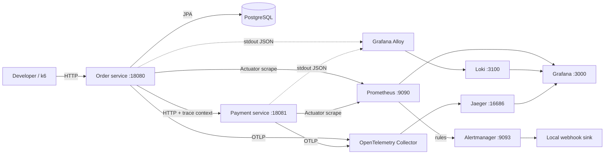

# Spring Boot Observability Lab

A local teaching system for understanding how Spring applications generate metrics, traces, and structured logs, and how Prometheus, Jaeger, Loki, Alloy, Alertmanager, and Grafana process those signals. It deliberately keeps the business domain small: an order is stored in PostgreSQL before a synchronous simulated payment request. It excludes real payment integration, authentication, production deployment, and automatic retries.

## Architecture



## Technology decisions

- Java 21 and Maven multi-module; Spring Boot **3.5.16** is a stable 3.5 maintenance release and supports Java 21. Dependencies come from the Boot BOM. See [Spring Boot 3.5 system requirements](https://docs.spring.io/spring-boot/3.5/system-requirements.html).
- Spring MVC, Bean Validation, Spring Data JPA, and PostgreSQL 17.6 provide a small but real synchronous workflow and DB pool metrics.
- Actuator and Micrometer Prometheus registry expose framework and business metrics. Timer histograms are enabled for HTTP and order processing. Counters use bounded outcome labels; a pending-work gauge represents current state.
- Business endpoint telemetry is applied by Spring AOP aspects on annotated controller methods. Controller methods contain request validation and workflow logic; the aspects own business counters, the order processing observation/timer and pending gauge, and structured outcome logs. Demo endpoints that intentionally generate telemetry retain their demonstration-specific instrumentation.
- Micrometer Tracing with the OpenTelemetry bridge and OTLP exporter is the sole instrumentation strategy. The Collector forwards traces to Jaeger. Sampling is 100% for local learning.
- Spring Boot structured console logging emits JSON. Alloy discovers Docker containers and sends stdout logs to Loki; only low-cardinality service name and level are extracted as Loki labels. Trace IDs remain JSON fields.
- Prometheus evaluates local rules and sends notifications to a small local webhook sink. No external credentials or notification service are needed.
- Grafana provisions Prometheus, Loki, and Jaeger data sources and two dashboards on startup.
- All image tags are pinned in Compose: Prometheus 3.5.0, Grafana 12.0.2, Jaeger 1.72.0, OTel Collector Contrib 0.130.0, Loki 3.5.3, Alloy 1.10.2, Alertmanager 0.28.1, PostgreSQL 17.6, and k6 1.1.0. The locally built app images use explicit `1.0.0` tags; their Eclipse Temurin 21 JRE and Python 3.13 Alpine bases are pinned by manifest digest in the Dockerfiles. Use the component docs to review upgrades before changing these pins.

## Prerequisites

- macOS or Linux; Docker Desktop/Engine with Compose v2, 4+ GB memory recommended.
- JDK 21 and Maven 3.6.3+ to build and run the apps directly.
- Ports 18080, 18081, 3000, 3100, 4317, 4318, 9090, 9093, 12345, and 16686 available. PostgreSQL port 5432 stays internal. If needed, set `ORDER_PORT` or `PAYMENT_PORT` in `.env` to change host mappings. Only the user-facing development ports are published by Compose (database stays internal).
- Docker socket access is needed by Alloy to discover container logs. Docker Desktop exposes this socket to its VM; check Docker Desktop settings if Alloy cannot connect.

## Quick start

```bash
cp .env.example .env   # optional: defaults are local-only demo credentials
make up
make status
curl -i -H 'Content-Type: application/json' \
  -d '{"item":"notebook","amount":8.75}' \
  http://localhost:18080/api/orders
```

The order is committed before the payment call, so a payment failure leaves an order row with `PAYMENT_FAILED`. That boundary keeps the demo outcome inspectable; this simplified workflow is not a distributed transaction and has no compensating payment protocol.

For direct IDE runs, start PostgreSQL with Compose (`docker compose up -d postgres`), then in separate terminals run `mvn -pl apps/payment-service spring-boot:run` and `mvn -pl apps/order-service spring-boot:run`. The order service defaults to localhost ports and local credentials. OTLP ports 4317 and 4318 are published for direct IDE runs. The payment RestClient uses a two-second connect timeout and seven-second response timeout; Hikari connection acquisition is capped at three seconds. To enable controlled demo endpoints outside Compose, set `DEMO_ENABLED=true`; keep that setting confined to local development.

## Service URLs

| Service | URL | Local login |
|---|---|---|
| Order API, health, metrics | http://localhost:18080, http://localhost:18080/actuator/health, http://localhost:18080/actuator/prometheus | — |
| Payment API, health, metrics | http://localhost:18081, http://localhost:18081/actuator/health, http://localhost:18081/actuator/prometheus | — |
| Grafana | http://localhost:3000 | `admin` / `admin` (override with `.env`) |
| Prometheus | http://localhost:9090 | — |
| Alertmanager | http://localhost:9093 | — |
| Jaeger | http://localhost:16686 | — |
| Loki API | http://localhost:3100 | — |
| Alloy UI | http://localhost:12345 | — |

A successful create returns HTTP 201 with an order record, for example `{"id":42,"item":"notebook","amount":8.75,"outcome":"PAID","createdAt":"2026-10-30T14:00:00Z"}`. Invalid JSON fields return a 400 Problem Details body such as `{"title":"Bad Request","status":400,"detail":"Invalid request"}`. A missing ID returns 404 with `detail":"Order not found"`; the controlled application error returns 500 with a generic detail; a simulated downstream failure returns 502 with `{"outcome":"PAYMENT_FAILED"}`. An amount above 5000 is a successful order creation with `outcome":"DECLINED"`.

Demo routes exist only when `DEMO_ENABLED=true` (Compose enables them): `GET /api/demo/slow?ms=1200`, `/api/demo/failure`, `/api/demo/payment-failure?delayMs=800`, and `/api/demo/cardinality?series=100`. The cardinality route creates synthetic labels, caps at 500 series per process, and is only enabled with the local demo flag. The slow and delay values are capped at five seconds. Payments above 5000 are a business decline. Invalid input returns 400; missing order IDs return 404; unexpected demo exceptions return 500; controlled downstream outage returns 502.

## First investigation

1. POST one order using Quick start.
2. In Grafana Explore / Prometheus, query `orders_accepted_total` and `rate(http_server_requests_seconds_count{job="order-service"}[5m])`.
3. In Grafana Explore / Loki, select `{service_name="order-service"}` and search `|= "Order processing completed"`; open a JSON entry and copy `traceId`.
4. In Jaeger search for service `order-service`, inspect the HTTP server span and payment-service child span, and compare the trace ID. Database spans depend on the JDBC instrumentation present in the selected Boot/Micrometer stack; do not assume one exists unless visible.

## PromQL reference

The names below follow Micrometer's Prometheus naming convention; confirm available series at `/actuator/prometheus` after building. Histograms are enabled for `http.server.requests` and `orders.processing`.

| Investigation | Query | Meaning and interpretation |
|---|---|---|
| Request throughput | `sum by (job) (rate(http_server_requests_seconds_count[5m]))` | Requests/sec by scrape job. A rate smooths short bursts. |
| Server errors | `sum by (job) (rate(http_server_requests_seconds_count{status=~"5.."}[5m]))` | 5xx/sec; inspect individual requests in traces/logs. |
| Error proportion | `sum(rate(http_server_requests_seconds_count{status=~"5.."}[5m])) / clamp_min(sum(rate(http_server_requests_seconds_count[5m])), 0.01)` | Fraction of all requests failing. Low volume makes ratios noisy. |
| p50 / p95 / p99 | `histogram_quantile(0.95, sum by (le,job) (rate(http_server_requests_seconds_bucket[5m])))` (replace 0.95 with 0.50 or 0.99) | Estimated quantile from aggregated buckets; not an exact observation. |
| Business throughput | `sum(rate(orders_accepted_total[1m])) * 60` | Order create events/minute. Counter resets are handled by `rate`. |
| Payment outcomes | `sum by (outcome) (rate(payments_attempts_total[5m]))` | Successful and failed order-service payment attempts/sec. |
| Order outcomes | `sum by (outcome) (rate(orders_outcomes_total[5m]))` | Paid, declined, and payment_failed orders/sec. |
| JVM heap | `sum by (job) (jvm_memory_used_bytes{area="heap"})` | Current heap usage; compare to max and GC. |
| GC activity | `sum by (job) (rate(jvm_gc_pause_seconds_sum[5m]))` | Seconds spent paused per second; not a pause count. |
| DB pool active | `sum by (job) (jdbc_connections_active)` | Current Hikari active connections; compare with `jdbc_connections_max`. |
| Downstream latency | `histogram_quantile(0.95, sum by (le) (rate(http_server_requests_seconds_bucket{uri="/api/payments"}[5m])))` | Payment-service server-side p95; use trace client span for caller view. |
| Order processing | `histogram_quantile(0.95, sum by (le) (rate(orders_processing_seconds_bucket[5m])))` | End-to-end controller timer distribution. |

Timers export count, sum, and (when histogram configured) buckets. A timer average (`rate(sum)/rate(count)`) can hide a slow tail; p95 from buckets makes tail latency visible and can be aggregated, but bucket quantization introduces error. Never average instance p95s to derive fleet p95.

## LogQL reference

- Order service warnings: `{service_name="order-service", level="WARN"}`
- Payment failures in logs: `{service_name="payment-service", level="WARN"} |= "payment.failed"`
- Find a trace-correlated event: `{service_name="order-service"} | json | traceId="<trace-id>"` (trace ID stays content, not an index label)
- Inspect server errors: `{service_name="order-service", level="ERROR"}`

## Alerting

`ElevatedServerErrorRate` uses a rolling five-minute 5xx ratio above 10%, requires at least 0.2 requests/sec to avoid firing on tiny test samples, evaluates every 10 seconds, and has a two-minute pending period. It is warning severity; inspect traces and logs, then compare deploys/dependencies. `ApplicationUnavailable` fires for a scrape target down for one minute and is critical; check readiness and container health. A condition first becomes pending, then firing after `for`, then resolved when false. Small traffic volumes can make ratios unstable. Alertmanager routes to the local sink; inspect `docker compose logs alert-sink` or the Alertmanager UI.

## Experiments

Start with [Experiment 01](experiments/01-first-telemetry.md), then follow 02–10 in order. They cover metrics/histograms, traces, latency, failures, cross-signal correlation, alerting, cardinality, load, and telemetry infrastructure failures.

## Commands

- `make up`, `make down`, `make status`, `make logs`
- `make test`, `make smoke-test`
- `make load-normal`, `make load-burst`, `make load-degraded` (normal/degraded accept `VUS` and `DURATION`; burst accepts `RAMP_SECONDS`, `BURST_SECONDS`, and `BURST_VUS`)
- `make clean` stops/removes containers but retains volumes; `make reset` deliberately deletes all named volumes and stored data.
- Rebuild with `make build`; Compose rebuilds images during `make up`.

## Testing and smoke verification

`make test` runs both Maven test suites. `make smoke-test` builds the jars, starts or updates the stack, and checks readiness, creates an order, exercises application and downstream failures, checks both Prometheus exposition endpoints and targets, verifies a cross-service trace and ingested order log, and checks Grafana provisioning and alert rules. It uses bounded readiness polling rather than a fixed startup sleep. Log ingestion and dashboards should also be confirmed in Grafana Explore after startup; a backend health endpoint cannot prove a specific log has arrived.

## Troubleshooting

- **Port conflict:** use `lsof -nP -iTCP:PORT -sTCP:LISTEN`, stop the conflicting local process, or edit the published port mapping.
- **Docker unavailable/resources exhausted:** verify Docker Desktop is running and grant it adequate memory/CPU; run `docker compose ps` and `docker compose logs SERVICE`.
- **Unhealthy application:** inspect Postgres readiness and `docker compose logs order-service payment-service postgres`.
- **Prometheus target down/missing metrics:** inspect `/actuator/prometheus`, endpoint exposure, container DNS, and Prometheus Targets.
- **Missing trace/propagation:** check Collector logs, OTLP endpoints, sampling, and Jaeger service search; ensure the application uses the injected `RestClient.Builder`.
- **Duplicate spans:** this configuration uses library instrumentation only; do not also attach the OpenTelemetry Java agent.
- **Missing logs / Alloy:** check socket access and Alloy logs/UI; macOS Docker Desktop differs from native Linux log access. Query `{service_name="order-service"}` or `{service_name="payment-service"}` in Loki.
- **Invalid PromQL / empty panel:** inspect actual exposition names first; metric suffixes are normalized by Micrometer's Prometheus registry.
- **Alert config:** `docker compose logs prometheus alertmanager alert-sink`; validate the mounted config after edits.

## Production considerations

This is a local educational configuration. Before production, add authentication/authorization, TLS, network boundaries, managed secrets, resource requests/limits, storage sizing and retention policies, backup/restore, high availability, sampling strategy, telemetry cost controls, cardinality budgets, PII and secret scrubbing, secured dashboards, alert ownership/runbooks, and monitoring for every telemetry backend. Keep failure/demo routes disabled. Review timeouts and queue behavior under exporter outages. Do not treat a laptop load run as capacity evidence.

## Current verification record

Verified on macOS arm64 with Java 21.0.3, Maven 3.9.6, Docker CLI 29.9.2, and Compose 5.6.1. The machine already had `ledgerflow` containers bound to host ports 8080 and 8081, so this lab publishes its APIs on 18080 and 18081; those containers were left untouched. `make test` passes (six tests), and the final `make smoke-test` passes, including app health, metrics, scrape targets, a cross-service trace, Grafana provisioning, Loki readiness, and alert configuration. Prometheus configuration and rules, and Alertmanager configuration, also passed their native validators. The documented PromQL expressions returned valid series after traffic. A k6 normal run (68 iterations) and burst run (5,955 requests) completed with no failed requests; a degraded-payment run also completed with no failed requests. A sustained controlled 5xx test fired `ElevatedServerErrorRate` and delivered a webhook to the local sink; a single isolated 5xx did not fire it, and the alert later resolved. With payment stopped, an order persisted as `PAYMENT_FAILED`; with the Collector stopped, an order still completed as `PAID`. The Compose stack remains running and its named data volumes are intact. These local runs demonstrate the configured paths, not production capacity or guarantees; database spans were not observed in this configuration.
